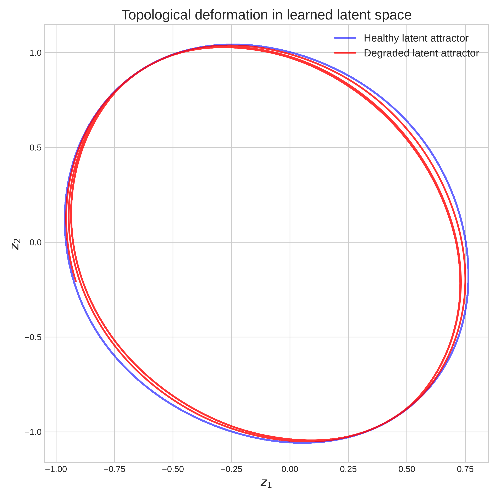
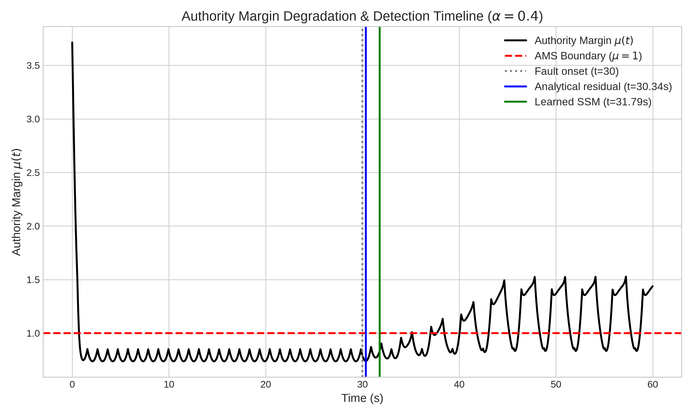
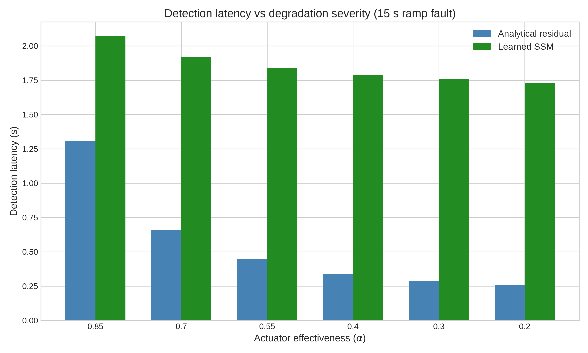

# Early Detection of Actuator Degradation via Learned Latent Dynamics in Overactuated Nonlinear Systems

## 1. Executive Summary
This report presents findings from a controlled benchmark investigating whether actuator degradation in a partially redundant, overactuated nonlinear system can be detected through deformation of a learned latent dynamical representation.

We demonstrate that as actuator effectiveness ($\alpha$) degrades along a 15-second incipient ramp, the physical Attainable Moment Set (AMS) shrinks asymmetrically and the closed-loop vector field deforms. A learned nonlinear state-space model (SSM), trained exclusively on healthy telemetry, captures this deformation. Mean detection latency is 1.85s for the SSM versus 0.55s for an analytical inverse-dynamics residual, on a 15s fault ramp, with zero false alarms on the healthy control run. Crucially, the SSM achieves this without access to the analytical plant drift equations.

## 2. Mathematical & Physical Framework
### 2.1 The plant and partial redundancy
The plant is a 2D Hopf normal form controlled by $m=3$ partially redundant actuators. The control effectiveness matrix $B \in \mathbb{R}^{2 \times 3}$ maps actuator commands $u$ to generalized forces $v = Bu$. Degradation is a diagonal effectiveness matrix $D(\alpha)$, so the delivered force is $v_{act} = B D(\alpha) u$. The nominal controller allocates with the healthy $B$, so degradation immediately produces a delivered-vs-commanded mismatch.

### 2.2 The Attainable Moment Set (AMS) and authority margin
Actuator limits ($|u_i| \le u_{max}$) define a convex polytope in generalized-force space, the AMS. Degradation shrinks it asymmetrically. The authority margin $\mu(t)$ is the ratio of demanded virtual control to the maximum deliverable force in that direction (the AMS support function). $\mu < 1$: sufficient authority. $\mu \ge 1$: demanded force exits the degraded AMS, causing saturation and loss of the tracking attractor. The objective is detection while $\mu$ remains safely below 1.

## 3. The Nonlinear Dynamics Finding
Under nominal conditions the closed loop possesses a stable tracking attractor. As $\alpha$ ramps down, effective control gain drops and the closed-loop vector field deforms before any macroscopic tracking failure. Figure 2 shows the learned latent dynamics reflect this: the healthy latent trajectory forms a tight orbit, while the degraded trajectory exhibits a distinct topological shift. This is evidence that the learned representation preserves qualitative dynamical structure relevant to diagnosis (proposal hypothesis H1/H2), subject to the learned-coordinate caveat in Section 6.3 of the project export.

## 4. Benchmark Results
Detectors: tracking error, analytical inverse-dynamics residual (oracle model baseline), CUSUM, EWMA, and the learned SSM. Fault: 15s linear effectiveness ramp starting at t=30s. Demand set to 0.85 of the healthy AMS worst-case radius so the AMS boundary is reached for severe degradation.

Figure 1 shows the $\alpha=0.4$ timeline: the margin decays as the AMS shrinks; the analytical residual fires at t=30.34s and the SSM at t=31.79s, both well before the boundary.

Figure 3 maps latency against severity.

### 4.1 Interpretation of the latency gap
The analytical residual is faster because it uses exact knowledge of the plant drift $f(x)$. The SSM operates purely from the temporal consistency of the learned latent manifold. Detecting an incipient ramp at ~1.85s mean latency (effectiveness dropped by roughly 12% of the ramp) without any plant model is the substantive result: the learned dynamical structure is sensitive to vector-field deformation, which is the diagnostic premise of the proposal.

## 5. Research Roadmap
1. **Fault isolation via null-space excitation.** Partial redundancy masks which actuator degraded. Inject high-frequency signals into the null space of $B$: zero net force when healthy, observable leakage when asymmetrically degraded.
2. **GNN+SSM hybrid.** Actuators as graph nodes, overlapping columns of $B$ as edges; GNN extracts redundancy topology, SSM handles temporal evolution.
3. **Latent-space fault-tolerant control.** Use the shared representation to re-weight control allocation before $\mu(t) \to 1$, retaining the nominal controller as baseline.
